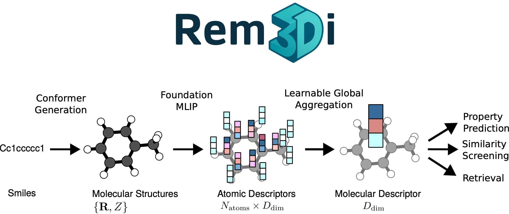

# Rem3Di: REpresentation learning for Molecules with 3D Information

<div align="center">
  <b>Learning smooth, chiral 3D molecular representations from equivariant atomistic foundation models</b>
  <br> <br>
  <a href="https://www.linkedin.com/in/steffen-wedig/" target="_blank">Steffen&nbsp;Wedig</a> &emsp; <b>&middot;</b> &emsp;
  <a href="https://www.felixburton.com" target="_blank">Felix&nbsp;Burton</a> &emsp; <b>&middot;</b> &emsp;
  <a href="https://www.linkedin.com/in/rokas-elijošius-9148a8147/" target="_blank">Rokas&nbsp;Elijošius</a><sup>*</sup> &emsp; <b>&middot;</b> &emsp;
  <a href="https://www.phy.cam.ac.uk/profile/dr-christoph-schran/" target="_blank">Christoph&nbsp;Schran</a><sup>*</sup> &emsp; <b>&middot;</b> &emsp;
  <a href="https://www.larsschaaf.com" target="_blank">Lars&nbsp;L.&nbsp;Schaaf</a><sup>*</sup>
  <br> <br>
  <a href="https://arxiv.org/abs/2607.19977" target="_blank"></a>
  &emsp;
  <a href="https://molsuit.github.io/Rem3Di/" target="_blank"></a>
  <br> <br>
</div>

<div align="center">
    
</div>


## Documentation

📖 Full usage docs (installation, quickstart, evaluating models, training
downstream heads, training from scratch, and concepts) are online at
**<https://molsuit.github.io/Rem3Di/>**.


## Setup

Install with [uv](https://docs.astral.sh/uv/) (requires Python >=3.12):

```bash
uv pip install remedi                     # PyTorch + MACE, descriptors on CPU or GPU
uv pip install "remedi[cuda]"             # adds the cuEquivariance GPU kernels
uv pip install "remedi[telemetry]"        # adds Weights & Biases logging of training runs
uv pip install "remedi-eval[descriptor-analysis]"  # tmQM chemistry and chemiscope exports
```

Or with pip:

```bash
pip install remedi
```

See the [installation docs](https://molsuit.github.io/Rem3Di/) for extras, GPU builds, and full detail.

## Raw dataset download
We work with a number of different datasets for benchmarking Rem3Di.

Scripts to download these datasets from can be found in scripts/dataset_download. All scripts take the target destination folder as their first argument.

Example: Geom Drugs can be downloaded by:

```bash
mkdir raw_datasets
bash scripts/dataset_download/download_geomdrugs.sh ./raw_datasets
```

## Generating a MoleculeDataset for Training
TL;DR: a preparer writes each corpus once as a dataset (`scripts/dataset_creation/prepare_structures.py`), subsets of it are selections (`scripts/dataset_creation/select_structures.py`), and a pretraining config names a mixture of datasets and selections (`configs/training/mixture_smoke/` has two examples).


### Dataset Overview
MoleculeDatasets (```packages/remedi-data/remedi_data/dataset/molecule_dataset.py```) is the object that contains all embedding and structural data for our molecular datasets. The datasets can further contain system wide, molecular labels, or atomwise labels, which can be used for training regression models. Our datasets are backed by zarr arrays(Design motivitation: multithreaded read access from disk, when dataset size exceeds memory limit). As the size of molecules varies, the MoleculeDataset contain pointer values that point to the molecules atom limits.

### Dataset Generation
Every corpus has a preparer under `packages/remedi-data/remedi_data/structures/sources/`. `scripts/dataset_creation/prepare_structures.py` runs one from a yaml config (one `kind` per source) and writes the structures (`MoleculeDataset`) plus a `table.parquet` with the ids and SMILES. MACE descriptors are computed during training, not stored.

## Running Pretraining
1. Write a training config whose `data` section names a mixture of datasets and selections, next to an architecture config (examples in `configs/training/mixture_smoke/`).
2. Submit it to DAIS: `uv run python scripts/submit_job.py <training_config.yaml> --time 06:00:00`. Each config is frozen into its training directory and runs as one `scripts/pretrain.slurm` job on an H200 or B200. To run in the current shell instead: `uv run python scripts/run_online_embedding_denoising_pretraining.py --training_config <training_config.yaml>`.

Training reads structures through `TrainingMoleculeDataset` (`remedi/training/data/training_dataset.py`), which lets several dataloader workers read the same zarr store at once.


## Using Pretrained Model

```python
from pathlib import Path

from remedi.embedding import RemediConfig
from remedi_data.dataset.molecule_dataset import MoleculeDataset

calculator = RemediConfig(name="my_model", model_dir=Path(model_dir)).build()
dataset = MoleculeDataset.open_existing_dataset_from_dir(dataset_path)
descriptors = calculator.calculate(dataset)  # (structures, descriptor length)
```

To score a checkpoint on the benchmark panel or run the descriptor-space analyses (`configs/evaluation/descriptor_analysis/`), use `scripts/evaluation/embed_and_evaluate.py`.

## Citation

If you use parts of this code in your work, please cite our paper
(<a href="https://arxiv.org/abs/2607.19977" target="_blank">arXiv</a>), first released at the NeurIPS 2025 Workshop on Symmetry and Geometry in Neural Representations. Arxiv:

<!-- > Wedig, S., Burton, F., Elijošius, R., Schran, C., & Schaaf, L. L. (2026). Rem3Di: Learning smooth, chiral 3D molecular descriptors from atomistic foundation models. arXiv preprint arXiv:2607.19977. -->

```bibtex
@article{wedig2026rem3di,
  title={REM3DI: Learning smooth, chiral 3D molecular representations from equivariant atomistic foundation models},
  author={Wedig, Steffen and Elijo{\v{s}}ius, Rokas and Schran, Christoph and Schaaf, Lars Leon},
  journal={arXiv preprint arXiv:2607.19977},
  year={2026},
  note={Previously released in 2025 at the NeurIPS 2025 Workshop on Symmetry and Geometry in Neural Representations}
}
```
